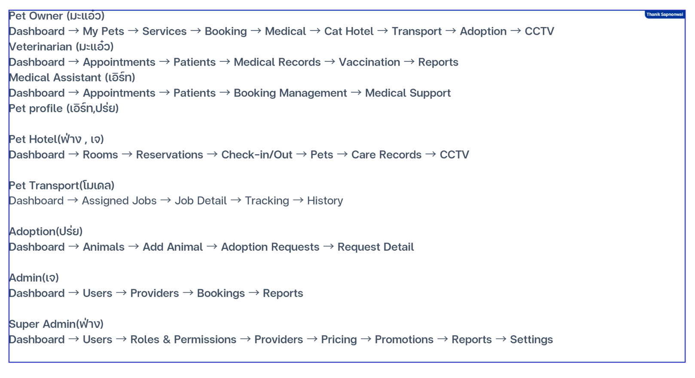

# PetCare — Page 17 Sitemap

แหล่งอ้างอิง: แผนผังหน้า 17 (Thanik Sapnonwai)



โครงนี้แยกตามบทบาท (role) เพื่อไม่ให้โค้ดและงานปนกัน แต่ละคนทำงานในโฟลเดอร์ของตัวเอง

---

## 1. Pet Owner (มะแอ่ว)

**โฟลเดอร์:** `src/features/pet-owner/`

```
Dashboard → My Pets → Services → Booking → Medical → Cat Hotel → Transport → Adoption → CCTV
```

| หน้า | ไฟล์ | Route |
|------|------|-------|
| Dashboard | `pages/Dashboard.jsx` | `/pet-owner` |
| My Pets | `pages/MyPets.jsx` | `/pet-owner/my-pets` |
| Services | `pages/Services.jsx` | `/pet-owner/services` |
| Booking | `pages/Booking.jsx` | `/pet-owner/booking` |
| Medical | `pages/Medical.jsx` | `/pet-owner/medical` |
| Cat Hotel | `pages/CatHotel.jsx` | `/pet-owner/cat-hotel` |
| Transport | `pages/Transport.jsx` | `/pet-owner/transport` |
| Adoption | `pages/Adoption.jsx` | `/pet-owner/adoption` |
| CCTV | `pages/Cctv.jsx` | `/pet-owner/cctv` |

---

## 2. Veterinarian (มะแอ่ว)

**โฟลเดอร์:** `src/features/veterinarian/`

```
Dashboard → Appointments → Patients → Medical Records → Vaccination → Reports
```

| หน้า | ไฟล์ | Route |
|------|------|-------|
| Dashboard | `pages/Dashboard.jsx` | `/veterinarian` |
| Appointments | `pages/Appointments.jsx` | `/veterinarian/appointments` |
| Patients | `pages/Patients.jsx` | `/veterinarian/patients` |
| Medical Records | `pages/MedicalRecords.jsx` | `/veterinarian/medical-records` |
| Vaccination | `pages/Vaccination.jsx` | `/veterinarian/vaccination` |
| Reports | `pages/Reports.jsx` | `/veterinarian/reports` |

---

## 3. Medical Assistant (เอิร์ท)

**โฟลเดอร์:** `src/features/medical-assistant/`

```
Dashboard → Appointments → Patients → Booking Management → Medical Support
```

| หน้า | ไฟล์ | Route |
|------|------|-------|
| Dashboard | `pages/Dashboard.jsx` | `/medical-assistant` |
| Appointments | `pages/Appointments.jsx` | `/medical-assistant/appointments` |
| Patients | `pages/Patients.jsx` | `/medical-assistant/patients` |
| Booking Management | `pages/BookingManagement.jsx` | `/medical-assistant/booking-management` |
| Medical Support | `pages/MedicalSupport.jsx` | `/medical-assistant/medical-support` |

---

## 4. Pet Profile (เอิร์ท, ปร่ย)

**โฟลเดอร์:** `src/features/pet-profile/`

โมดูลร่วม (shared) — ใช้ข้ามบทบาทได้

| หน้า | ไฟล์ | Route |
|------|------|-------|
| Pet Profile | `PetProfile.jsx` | `/pet-profile` |

---

## 5. Pet Hotel (ฟ่าง, เจ)

**โฟลเดอร์:** `src/features/pet-hotel/`

```
Dashboard → Rooms → Reservations → Check-in/Out → Pets → Care Records → CCTV
```

| หน้า | ไฟล์ | Route |
|------|------|-------|
| Dashboard | `pages/Dashboard.jsx` | `/pet-hotel` |
| Rooms | `pages/Rooms.jsx` | `/pet-hotel/rooms` |
| Reservations | `pages/Reservations.jsx` | `/pet-hotel/reservations` |
| Check-in/Out | `pages/CheckInOut.jsx` | `/pet-hotel/check-in-out` |
| Pets | `pages/Pets.jsx` | `/pet-hotel/pets` |
| Care Records | `pages/CareRecords.jsx` | `/pet-hotel/care-records` |
| CCTV | `pages/Cctv.jsx` | `/pet-hotel/cctv` |

---

## 6. Pet Transport (โมเดล)

**โฟลเดอร์:** `src/features/pet-transport/`

```
Dashboard → Assigned Jobs → Job Detail → Tracking → History
```

| หน้า | ไฟล์ | Route |
|------|------|-------|
| Dashboard | `pages/Dashboard.jsx` | `/pet-transport` |
| Assigned Jobs | `pages/AssignedJobs.jsx` | `/pet-transport/assigned-jobs` |
| Job Detail | `pages/JobDetail.jsx` | `/pet-transport/job-detail` |
| Tracking | `pages/Tracking.jsx` | `/pet-transport/tracking` |
| History | `pages/History.jsx` | `/pet-transport/history` |

---

## 7. Adoption (ปร่ย)

**โฟลเดอร์:** `src/features/adoption/`

```
Dashboard → Animals → Add Animal → Adoption Requests → Request Detail
```

| หน้า | ไฟล์ | Route |
|------|------|-------|
| Dashboard | `pages/Dashboard.jsx` | `/adoption` |
| Animals | `pages/Animals.jsx` | `/adoption/animals` |
| Add Animal | `pages/AddAnimal.jsx` | `/adoption/add-animal` |
| Adoption Requests | `pages/AdoptionRequests.jsx` | `/adoption/requests` |
| Request Detail | `pages/RequestDetail.jsx` | `/adoption/requests/:requestId` |

---

## 8. Admin (เจ)

**โฟลเดอร์:** `src/features/admin/`

```
Dashboard → Users → Providers → Bookings → Reports
```

| หน้า | ไฟล์ | Route |
|------|------|-------|
| Dashboard | `pages/Dashboard.jsx` | `/admin` |
| Users | `pages/Users.jsx` | `/admin/users` |
| Providers | `pages/Providers.jsx` | `/admin/providers` |
| Bookings | `pages/Bookings.jsx` | `/admin/bookings` |
| Reports | `pages/Reports.jsx` | `/admin/reports` |

---

## 9. Super Admin (ฟ่าง)

**โฟลเดอร์:** `src/features/super-admin/`

```
Dashboard → Users → Roles & Permissions → Providers → Pricing → Promotions → Reports → Settings
```

| หน้า | ไฟล์ | Route |
|------|------|-------|
| Dashboard | `pages/Dashboard.jsx` | `/super-admin` |
| Users | `pages/Users.jsx` | `/super-admin/users` |
| Roles & Permissions | `pages/RolesPermissions.jsx` | `/super-admin/roles-permissions` |
| Providers | `pages/Providers.jsx` | `/super-admin/providers` |
| Pricing | `pages/Pricing.jsx` | `/super-admin/pricing` |
| Promotions | `pages/Promotions.jsx` | `/super-admin/promotions` |
| Reports | `pages/Reports.jsx` | `/super-admin/reports` |
| Settings | `pages/Settings.jsx` | `/super-admin/settings` |
